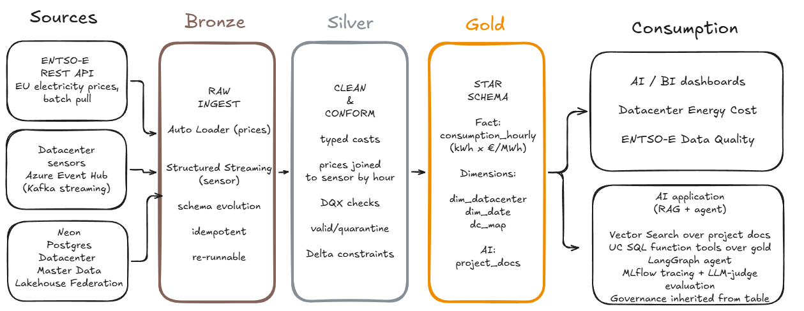

# Datacenter Energy Cost Platform

An end-to-end data platform on **Databricks + Azure** that answers one business question:
**what does it cost to power a fleet of datacenters, per site and per bidding zone, as wholesale
electricity prices move through the day – and which sites have gone silent?**

It ingests electricity prices and datacenter sensor telemetry, runs them through a governed
medallion architecture (bronze -> silver -> gold), serves analytics dashboards and a grounded
AI assistant on top, and ships to production **entirely through CI/CD** – nothing is built by
hand in prod.

Built as the individual Final Project for the SoftServe Databricks Academy.



- **Sources** – ENTSO-E REST API (prices, batch), datacenter sensors via Azure Event Hub
  (streaming), and datacenter master data in Neon Postgres (read live via Lakehouse Federation, snapshotted into bronze).
- **Medallion** – one declarative Lakeflow pipeline builds silver + gold with DQX quality checks;
  Lakeflow Jobs orchestrate ingestion, the pipeline, dimensions and dashboard refresh.
- **Consumers** – a Datacenter Energy Cost dashboard and a Data Quality scorecard, plus a RAG +
  agent AI application over the governed gold layer.
- **Governed by Unity Catalog** – catalogs / schemas / volumes, row-level security and column
  masks (RLS/CLS), with secrets in Azure Key Vault.

---

## Two environments, one bundle

Everything is deployed by a single Databricks Asset Bundle (`databricks.yml`, bundle name
`entsoe_silver`) with two targets. The same code runs in both; only the `${var.*}` values differ.

| | **dev** | **prod** |
|---|---|---|
| Workspace | Databricks Free Edition | Azure Databricks (`dbr_dev_trial`) |
| Catalog | `workspace` | `dbr_dev` |
| Schemas | `bronze` / `silver` / `gold` | `gabrielajaniszews786_bronze` / `_silver` / `_gold` |
| Bronze source | synthetic generator (no egress) | real ENTSO-E API + Azure Event Hub |
| Pipeline compute | serverless | serverless |
| Job compute | serverless | classic single-node cluster |

Because Free Edition has no internet egress and no Event Hub, dev seeds bronze with a synthetic
generator; prod pulls the real ENTSO-E API and streams sensor events through the Event Hub.

---

## Repository layout

The repo follows the Academy lab arc; each folder maps onto a stage of the platform.

| Folder | Role in the platform |
|---|---|
| `Lab1` | Fundamentals, Git, first dashboard |
| `Lab2` | Azure + Unity Catalog lakehouse setup |
| `Lab3` | Streaming / incremental ingest – ENTSO-E fetch, Event Hub producer, sensor Structured Streaming (**bronze**) |
| `Lab4` | Silver transforms, data quality, SCD, and the synthetic bronze generator (**silver**) |
| `Lab5` | First Lakeflow declarative pipeline (superseded by the Lab 7 version; kept as the classic-vs-declarative comparison) |
| `Lab6` | Gold star schema, BI dashboard, RLS/CLS governance (`07_RLS_CLS`) (**gold**) |
| `Lab7` | Unit + data-quality testing: `ldp_pipeline.py` (silver + DQX + gold), `silver_transformations.py`, `run_tests.py`, reconciliation, `dim_date`, `dc_map`, DQ dashboard |
| `Lab8` | CI/CD DEV -> PROD (this bundle, the GitHub Actions workflows, `GIT_WORKFLOW.md`) |
| `Lab9` | REST API / SDK automation – `orchestrator.py` triggers jobs programmatically |
| `Lab10` | Lakehouse Federation + CDC / SCD2 over Neon Postgres |
| `Lab11` | Zerobus – explored as an alternative sensor ingestion path (not wired into the production pipeline) |
| `GenAI` | AI capstone – RAG + LangGraph agent over the gold layer, AI-assisted development |
| `terraform` | Data-only inventory of the Azure infra (separate layer; not wired into CD) |
| `.github/workflows` | `pr_pipeline.yml`, `cd.yml`, `automation.yml` |

> Note: lab numbering drifted late in the course – the `GenAI` folder is the AI capstone, while
> `Lab11` is the Zerobus lab.

---

## Prerequisites

- A Databricks workspace (Free Edition for dev; Azure Databricks for prod) and the
  [Databricks CLI](https://docs.databricks.com/dev-tools/cli/) (bundles).
- Python 3.11 for the local test run (`pip install "pyspark==4.0.*" pytest`).
- Secrets (see below). No secret values live in this repo.

### Secrets

**Databricks secret scope `default2`** (create your own scope with these keys):

| Key | Used for |
|---|---|
| `gabriela-entsoe-token` | ENTSO-E API token (price fetch) |
| `eventhub-con-str-gabriela` | Azure Event Hub connection string (sensor stream) |

**GitHub repository secrets** (for CI/CD): `DATABRICKS_HOST`, `DATABRICKS_TOKEN`.

---

## Setup

Authenticate once per machine (no profile is hardcoded in `databricks.yml`, so each person can
name their profile freely):

```bash
# dev (Free Edition)
databricks auth login --host https://dbc-8697dee0-e1e6.cloud.databricks.com
# prod (Azure) – use the current prod host
databricks auth login --host https://adb-7405615123305702.2.azuredatabricks.net
```

---

## Run it

### dev

```bash
databricks bundle deploy -t dev
databricks bundle run tests_job     -t dev     # pytest unit tests, headless
databricks bundle run gold_dim_job  -t dev     # seed bronze -> pipeline -> dim_date -> reconciliation -> dashboards
```

`gold_dim_job` seeds bronze with the synthetic generator, runs the declarative pipeline
(silver + DQX + gold), builds the `dim_date` calendar from a date range, runs reconciliation,
and refreshes both dashboards.

### prod

```bash
databricks bundle deploy -t prod
databricks bundle run entsoe_pipeline_prod -t prod
```

`entsoe_pipeline_prod` runs the full flow: `fetch_prices` (ENTSO-E API) and `event_hub_task`
(sensor producer) in parallel, then `ingest_sensor` (Event Hub -> bronze), then `run_pipeline`
(silver + DQX + gold), then `build_dim_date` and `build_dc_map`, reconciliation, and a refresh of
both dashboards. It sends an email on failure.

> **Heads-up for demos:** on the shared Azure trial the classic pipeline compute cold-starts
> (~12 min queued at "Waiting for resources") before it runs. Trigger prod ahead of time, or
> demonstrate a live pipeline run on dev (serverless) and use prod for the deploy.

---

## CI/CD

| Workflow | Trigger | What it does |
|---|---|---|
| `pr_pipeline.yml` | PR to `main` | `unit-tests` (pytest in `Lab7`) + `validate` (`databricks bundle validate -t prod`). Both must pass; branch protection blocks the merge otherwise. Nothing is deployed. |
| `cd.yml` | push to `main` | `databricks bundle deploy -t prod`, then a smoke run of `tests_job`. Concurrency-guarded so prod always converges to the latest `main`. |
| `automation.yml` | manual (`workflow_dispatch`) | Runs `Lab9/orchestrator.py` to trigger a job via the Databricks SDK (REST/SDK automation demo). |

The flow is: branch -> PR (gate) -> merge -> automatic deploy + smoke. A re-deploy reports
`0 created/changed/deleted` (idempotent).

---

## Testing and data quality

- **Unit tests** – pure silver transforms (`clean_prices` / `clean_sensor`) are extracted into
  `Lab7/silver_transformations.py` and tested with pytest. The same suite runs three ways: locally
  (CI), on Databricks Connect (serverless debugging), and headless as `tests_job`.
- **Data quality** – the pipeline runs a DQX suite across five dimensions. Rejected rows are
  **quarantined** (kept for inspection), not dropped; Delta `NOT NULL` / `CHECK` constraints apply.
- **Reconciliation** – `Lab7/07_reconciliation.ipynb` checks row counts, referential integrity
  (fact -> dim, 0 orphans) and silver -> gold aggregates, and raises on mismatch.

## Governance

Unity Catalog governs the whole platform: catalogs / schemas / volumes per environment, row-level
security and column masks defined on the gold tables (`Lab6/07_RLS_CLS`), and all credentials in a
secret scope backed by Azure Key Vault. The AI agent inherits RLS/CLS from the table it queries –
there is no access-control code in the agent itself.

## Advanced capabilities

Beyond the baseline, the platform uses three: **REST API automation** (ENTSO-E ingest + the SDK
orchestrator), **Lakehouse Federation** (datacenter master read live from Neon Postgres and snapshotted into
bronze), and
**CDC / SCD2** (auto-CDC on the sensor stream in the Lakeflow pipeline, plus a history-tracked
`dim_datacenter` in silver). A separate SCD2-over-Neon build in `Lab10` demonstrates the same
capability on the federated dimension but is not wired into the pipeline. Zerobus was evaluated as an
alternative sensor ingestion path but not adopted – the production pipeline stays on the classic
Event Hub + Structured Streaming route.

## AI application

A RAG + LangGraph agent over the governed gold layer (`GenAI/`): Unity Catalog SQL function tools
for the numbers, Vector Search retrievers for documentation (project READMEs + the ENTSO-E
glossary), MLflow tracing, and an LLM-judge evaluation on a golden set. A grounded-vs-no-context
comparison shows retrieval grounding answers in real data instead of fabrications. See
`GenAI/README.md`.

## Design decisions and trade-offs

For the reasoning behind the architecture, the cost/performance trade-offs, and where AI-assisted
development helped (with the guardrails used), see the project write-up in `docs/`.
